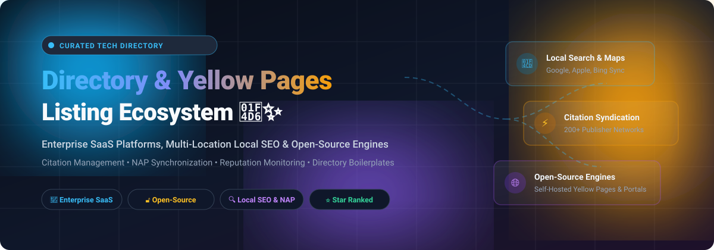

# 📖 Awesome Directory & Yellow Pages Listing Ecosystem 🌐

  

  
  
  
  
  
  

---

## 🧭 Executive Overview & SEO Meta Summary

Welcome to the definitive **Awesome Directory & Yellow Pages Listing Ecosystem** index! 🚀 This curated repository comprehensively catalogs enterprise **SaaS listing management platforms**, **local SEO citation software**, **multi-location NAP (Name, Address, Phone) synchronization hubs**, and **self-hosted open-source directory website templates**. 

Whether you are an enterprise SEO specialist optimizing multi-location franchise presence across Google Business Profile, Apple Maps, and Bing, or a full-stack developer architecting niche yellow pages and community resource portals using Next.js, Astro, or WordPress—this resource provides granular pricing, free trial limits, corporate scale metrics, and open-source star rankings to accelerate your architectural decisions.

---

## 📑 Table of Contents
- [📊 Sector Overview & Market Dynamics](#-sector-overview--market-dynamics)
- [🏢 SaaS & Hosted Listings Management Platforms](#-saas--hosted-listings-management-platforms)
- [💻 Open-Source GitHub Projects](#-open-source-github-projects)
- [🔌 WordPress Plugin Directory Solutions](#-wordpress-plugin-directory-solutions-non-github-hosted)
- [🤝 How to Contribute](#-how-to-contribute)
- [💖 Support & Sponsorship](#-support--sponsorship)
- [📈 Star History](#-star-history)
- [⚠️ Disclaimer](#-disclaimer)

---

## 📊 Sector Overview & Market Dynamics

The global **local listing management software market** is currently valued at approximately **$3.66 billion (2025–2026)** and is projected to expand to **$10 billion by 2035** at a Compound Annual Growth Rate (CAGR) of ~9.8%, while the broader **local SEO software and analytics industry** represents an **$9.85B+ annual market**. 

The sector is **moderately fragmented yet top-heavy**: enterprise distribution contracts and direct API syndication to primary data aggregators (Factual/Foursquare, Neustar Localeze, Data Axle, Google, Apple, Yelp) are dominated by a select cohort of incumbent leaders (Yext, Uberall, Birdeye), whereas specialized SMB niches, automated programmatic landing page generation, and self-hosted directory engines remain highly fragmented and competitive with dynamic open-source alternatives.

---

## 🏢 SaaS & Hosted Listings Management Platforms

*Sorted by company scale (Revenue / Valuation) in descending order.*

| Product 🏷️ | Scale (Revenue / Valuation) 🏛️ | Description 📝 | Pricing (Starting) 💳 | Free Tier / Trial Limits ⏱️ |
|---|---|---|---|---|
| **[Thryv](https://www.thryv.com/)** | **~$785M Revenue (2025)** • SaaS segment: $461M ARR • Enterprise Value: ~$290M | Comprehensive small business management and marketing suite consolidating CRM, automated appointment scheduling, billing, and automated listings distribution across 60+ online directories. | **$99/month** (Starter package for single location listing sync) | **No free-forever plan**; **14-day free trial** with access to core dashboard tools and appointment workflows (no credit card required upfront). |
| **[Yext](https://www.yext.com/)** | **~$446.6M Revenue (FY2026)** • Market Cap: ~$755M | Enterprise digital presence platform offering direct two-way API integrations with 200+ publishers, knowledge graphs, review response workflows, and locator landing pages. | **$199/month** (~$2,400/year; starting at ~$1,000–$3,000/location/year for single-product listings; onboarding setup fees range $2,000–$20,000) | **No free-forever plan**; **no self-serve free trial**; interactive live sandbox demo provided upon request via sales engineers. |
| **[Birdeye](https://birdeye.com/)** | **~$120M–$146M ARR** • Valuation: ~$1.5B–$2B (Private) | AI-powered local reputation, listing management, and customer experience platform built specifically for multi-location enterprises, healthcare networks, and retail brands. | **$299/location/month** (Starter Plan; billed annually with mandatory 1-year contract agreement) | **No free-forever plan**; **30-day free trial** restricted exclusively to Birdeye Social AI (core listings require custom sales walkthrough demo). |
| **[Uberall](https://uberall.com/)** | **~$84.7M Revenue** • Historical Valuation: ~$500M+ (Private) | Multi-location hybrid customer experience platform synchronizing store listings, local social posts, local pages, and AI search visibility across 1.4M+ locations globally. | **~$40–$50/location/month** (Core *Show Up* listings tier; typically requires minimum contract threshold of 25+ locations on annual terms) | **No free-forever plan**; **no public self-serve free trial**; guided proof-of-concept audit and sandbox demo scheduled via enterprise sales. |
| **[Moz Local](https://moz.com/local)** | **~$61M Revenue (Subsidiary)** • Owned by Ziff Davis (NASDAQ: ZD) | Streamlined local citation submission and automated listing distribution platform across major search engines, directories, and mapping apps with duplicate detection. | **$16/month** (Lite Plan billed annually at $199/year per location; or $20 month-to-month) | **No free-forever plan**; **no trial for Moz Local** (Moz Pro offers 7 days); includes free "Check My Presence" instant local listing audit scanner. |
| **[BrightLocal](https://www.brightlocal.com/)** | **~$20M ARR (2025)** • Bootstrapped / Private | Specialist local SEO platform offering Google Business Profile auditing, citation tracking, local search rank tracking, and manual citation syndication. | **$39/month** (Track plan; pay-as-you-go Citation Builder manual submissions cost $2.00–$3.20 per citation) | **No free-forever plan**; **14-day full-featured free trial** covering rank tracking, citation audits, and reputation monitoring (no credit card required). |
| **[Synup](https://synup.com/)** | **~$10.4M–$13.4M Revenue** • Backed by Vertex Ventures (Private) | Agent-powered listings, directory syndication, and digital voice/map profile optimizer with automated NAP sync across 60+ search, social, and directory networks. | **$39/month** (Solo package for 1 location billed annually; 10 locations bundle available at $239/month) | **No free-forever plan**; **14-day free trial** supporting full listing verification, location setup, and citation audit features (cancel anytime). |

---

## 💻 Open-Source GitHub Projects

*Self-hosted directory templates, yellow pages boilerplates, and local business platforms sorted by GitHub_Stars (descending).*

| Project 🛠️ | Stars_Count Badge ⭐ | Description 📌 |
|---|---|---|
| **[Pintree](https://github.com/Pintree-io/pintree)** |  | **Turn browser bookmarks into a directory website in minutes.** Lightweight and modern directory site generator with responsive layout, instant client-side search, export workflows, and monetization-ready advertising zones. **Best for curated resource directories, link yellow pages, and developer tool hubs.** |
| **[Cult Directory Template](https://github.com/nolly-studio/cult-directory-template)** |  | **Full-stack directory boilerplate built with Next.js, shadcn/ui, and Supabase.** Features user authentication, tag and category filtering, automated submission flows, customizable color themes, and admin moderation dashboards. **Best for modern directory web apps with user-submitted business or product listings.** |
| **[mkdirs](https://github.com/MkThingsHQ/mkdirs)** |  | **Open-source AI-powered directory website template built with Next.js.** Includes automated SEO metadata generator, category taxonomy sorting, search indexing, responsive listing cards, and developer-friendly Markdown/JSON configuration. **Best for AI directory platforms, niche product listings, and service directories.** |
| **[Minted Directory Astro](https://github.com/masterkram/minted-directory-astro)** |  | **Markdown-driven directory website template built with Astro and Tailwind CSS.** High-performance static site generation optimized for 100/100 Core Web Vitals, Schema.org local SEO structures, and fast client-side filtering. **Best for ultra-fast, content-first directory and yellow pages sites.** |
| **[Slash Packaging](https://github.com/kepano/slashpackaging)** |  | **Public business directory tracking sustainable packaging policies across global brands.** A clean, transparent static directory schema demonstrating how community-maintained GitHub data repositories power niche yellow pages. |
| **[HivePress](https://github.com/hivepress/hivepress)** |  | **Extensible directory and listings framework for WordPress.** Powers business directories, service marketplaces, job boards, and classifieds with customizable listing fields, faceted search filters, location-based queries, and listing monetization add-ons. **Best for WordPress directory portals.** |
| **[Local Business Builder](https://github.com/savvity/local-business-builder)** |  | **Programmatic SEO generator for local business websites.** Builds 80–100+ hyper-targeted local service and location landing pages using Astro 5, Tailwind CSS v4, and Cloudflare Pages. **Best for local SEO agencies and programmatic citation landing pages.** |
| **[Green Book App](https://github.com/spicygreenbook/greenbook-app)** |  | **Virtual business directory and mobile application for food & beverage businesses.** Built with React Native and modern web interfaces to showcase local food businesses, interactive maps, contact profiles, and merchant stories across the US and Canada. |
| **[Connections Business Directory](https://github.com/Connections-Business-Directory/Connections)** |  | **Feature-rich open-source business and member directory plugin for WordPress.** Offers extensive field customizer, multi-category hierarchies, address and phone directory lookups, role-based entry management, and CSV export/import support. |
| **[BusinessDirectory](https://github.com/chamuditha4/BusinessDirectory)** |  | **Modern open-source business directory built with Next.js, TypeScript, and Tailwind CSS.** Deployable to **Cloudflare Workers** for global edge performance. Uses PostgreSQL with automatic table creation for businesses, categories, and service options, synced from JSON via `pnpm run sync-postgresql`. |
| **[Laravel Business Directory](https://github.com/OfficialOzioma/business-directory)** |  | **Modular business directory application built with Laravel.** Features merchant profiles, category browsing, location-based listing sorting, and administrative listing moderation workflows. |
| **[LDD Directory Lite](https://github.com/lddweb/ldd-directory-lite)** |  | **Compact, lightweight WordPress business directory plugin.** Quickly embeds searchable business listings, contact information, social links, and Google Maps integration without theme lock-ins. |
| **[Open Business Directory](https://github.com/BetaNYC/open-business-directory)** |  | **Civic-tech open business directory by BetaNYC.** Connects directly to Airtable or Google Sheets as the listing database to deliver searchable directories of essential local merchants for municipal and community websites. |
| **[Bettiah Business Directory](https://github.com/SnakeEye-sudo/Bettiah-Business-Directory)** |  | **Crowd-sourced local business directory and review portal.** Integrates OpenStreetMap, static local data stores, listing submission forms, and verified community reviews tailored for municipal and neighborhood commerce. |
| **[Native-Owned Businesses Directory](https://github.com/nativesintech/native-owned-businesses)** |  | **Open-source community directory by Natives in Tech.** Designed to curate and highlight Indigenous-owned businesses, featuring categorized business listings, geographic metadata, and accessible web UI. |

---

## 🔌 WordPress Plugin Directory Solutions (Non-GitHub Hosted)

| Project 🧩 | Platform Link 🔗 | Description 📝 |
|---|---|---|
| **[TurnKey Directories](https://wordpress.org/plugins/turnkey-directories/)** | [WordPress.org Plugin](https://wordpress.org/plugins/turnkey-directories/) | **Full-featured WordPress business directory plugin with dynamic virtual page generation.** Features Leaflet/OpenStreetMap maps on directory pages, admin listing editor with Nominatim geocoding, Schema.org LocalBusiness markup, dynamic virtual pages, and XML/HTML sitemaps. |
| **[Adler Business Directory](https://wordpress.org/plugins/adler-business-directory/)** | [WordPress.org Plugin](https://wordpress.org/plugins/adler-business-directory/) | **Clean, lightweight WordPress business directory plugin.** Designed for member, staff, community, and local business listings with AJAX search, categorized shortcode embeds, and photo galleries without form-builder bloat. |

---

## 🏗️ Architectural Selection Framework

* **Full-Stack Dynamic Applications**: Choose **Cult Directory Template** (Next.js/Supabase), **mkdirs** (AI/Next.js), or **BusinessDirectory** (Cloudflare Workers/PostgreSQL) when you need user registration, business claims, and serverless scalability.
* **Jamstack & Static Sites**: Choose **Minted Directory Astro** or **Pintree** for top-tier Lighthouse scores, programmatic SEO speed, and minimal hosting costs.
* **WordPress Ecosystems**: Choose **HivePress**, **Connections**, or **TurnKey Directories** for instant CMS integration, visual page builder support, and turnkey listing management.
* **Commercial Syndication**: Open-source tools generate directories that *you own on your server*—they do **not** distribute data to third-party publisher ecosystems. For syndicating NAP information to Google Maps, Apple Maps, Yelp, and Bing, commercial platforms (Yext, BrightLocal, Synup) are essential.

---

## 🤝 How to Contribute

Contributions are warmly welcomed! Help keep this directory modern and comprehensive:
1. 🍴 Fork the repository.
2. 📝 Add or update entries in `README.md` following the established table formats.
3. 🔍 Ensure descriptions remain objective, technical, and accurately referenced.
4. 🚀 Submit a Pull Request detailing your changes.

---

## 💖 Support & Sponsorship

If this curated directory has helped you architect a directory solution, evaluate SaaS tooling, or discover open-source listing repositories, please consider supporting the project:

- ⭐ **Star this repository** to improve visibility for the community!
- 🍴 **Fork and share** with colleagues, marketers, and developers building local SEO software.
- ☕ **Buy a coffee or become a sponsor**: Support ongoing open-source maintenance via the [GitHub Sponsor Dashboard](https://github.com/sponsors/ishandutta2007).

---

## 📈 Star History

---

## ⚠️ Disclaimer

- This repository is a **community-curated guide** intended for informational and educational purposes; inclusion does not constitute a formal commercial endorsement.
- Directory listing platforms process consumer and business contact data; maintain proper data compliance (GDPR, CCPA), verify accurate address data, and follow local consumer protection laws.
- **Open-source software builds directories you host—they do not replace commercial listing syndication.** TurnKey Directories and BusinessDirectory create searchable web portals under your domain, but do not push updates to Google Business Profile or external publisher networks. Validate your business requirements before committing to enterprise subscriptions.

---

  <b>Built for local SEO marketers, multi-location brands, and developers engineering yellow pages infrastructure. 🌟</b>

